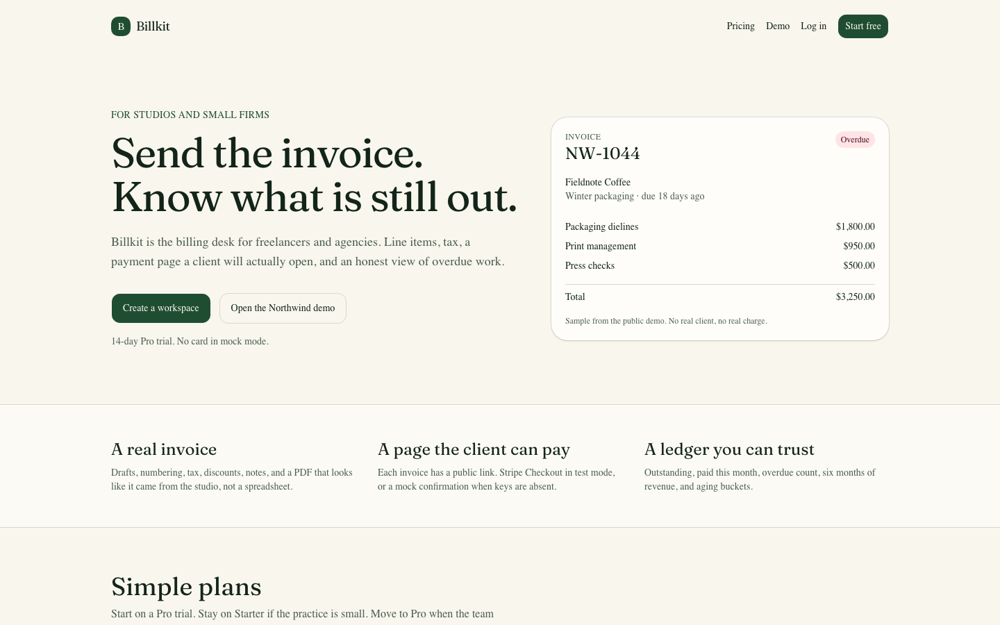
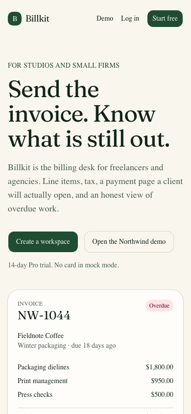
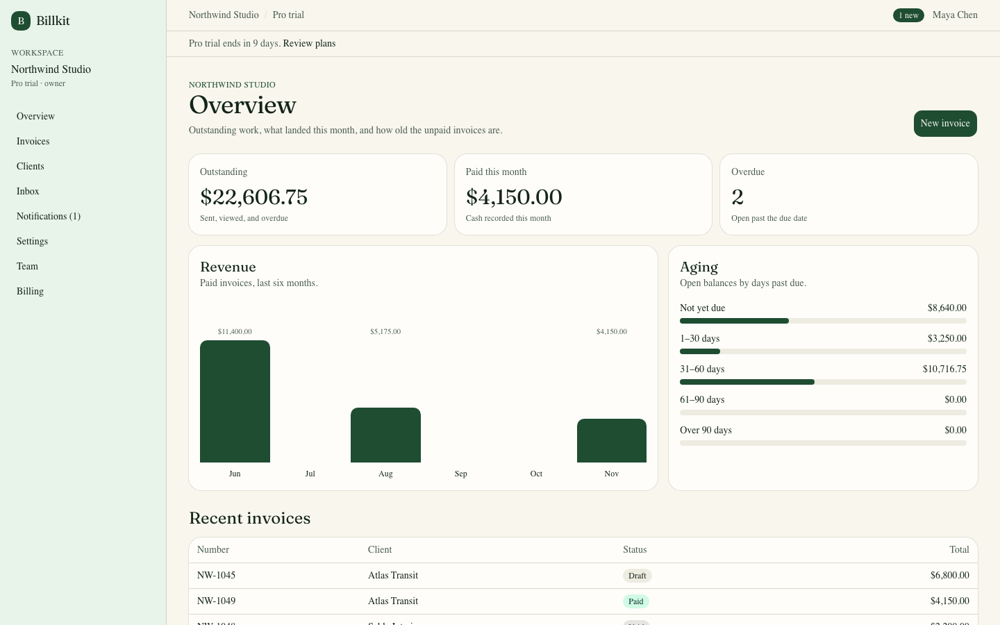
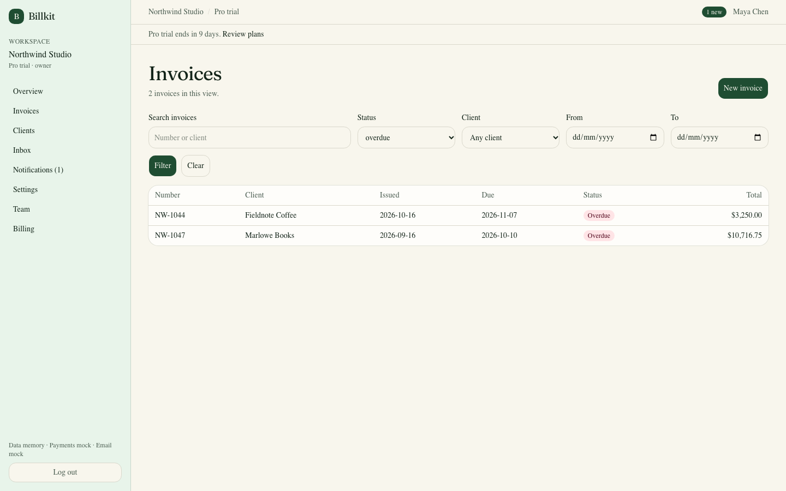
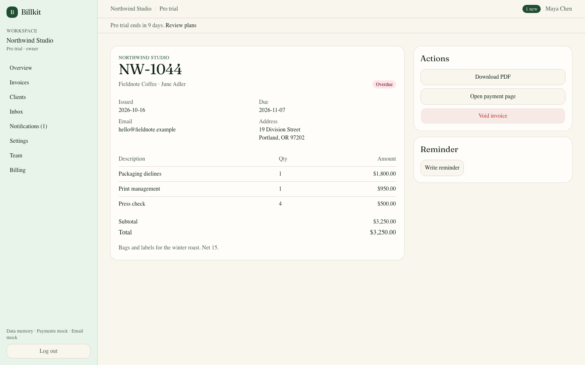
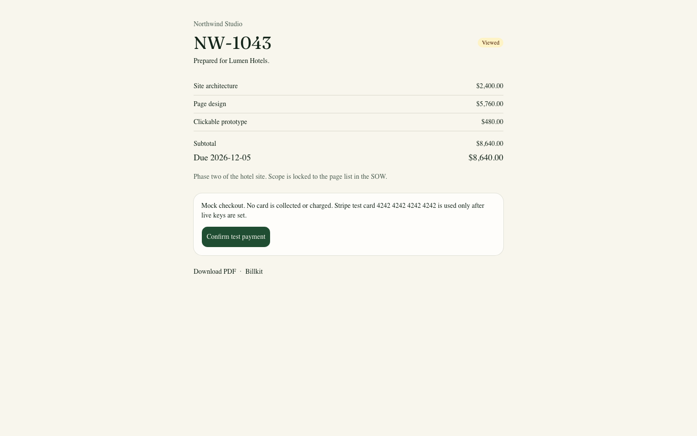
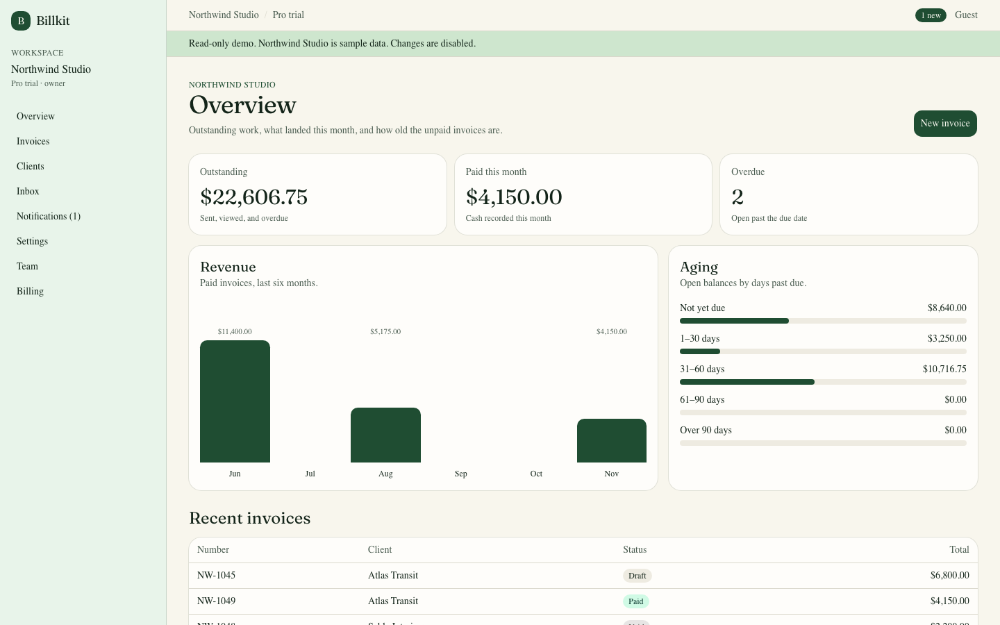
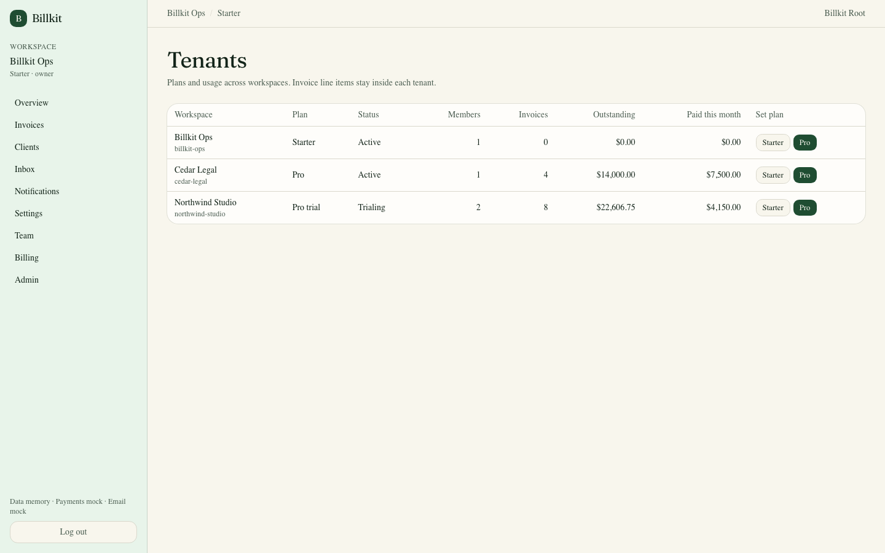

# Billkit

Billkit is a multi-tenant invoicing app for freelancers and small studios. A workspace has an owner and members, clients, and invoices with line items, tax, discounts, notes, and automatic numbering. Invoices move through draft, sent, viewed, paid, overdue, and void. Clients pay from a public page. The studio sees outstanding balances, cash this month, an overdue count, six months of revenue, and an aging ledger.

With no environment variables the app runs entirely in mock mode: passwords, magic links, email, Stripe checkout, and reminder copy all complete inside the process. Add Supabase, Stripe, Resend, or an LLM key and the same screens call the live service.

## Screenshots

















## Run locally

Node.js 22 or newer.

```bash
npm install
npm run dev
```

Open [http://127.0.0.1:3847](http://127.0.0.1:3847). No `.env` file is required.

| Script | What it does |
| --- | --- |
| `npm run dev` | Dev server on port 3847 |
| `npm run build` && `npm start` | Production server |
| `npm test` | Unit tests for money, status, aging, and plans |
| `npm run test:e2e` | Playwright: auth, send, pay, overdue, demo, isolation |
| `npm run typecheck` | `next typegen && tsc --noEmit` |
| `npm run lint` | ESLint |

Mock data lives in memory for the life of the Node process. A new process reloads the seed. That is enough for local use, Playwright, and a single Vercel instance. Production tenants should use Supabase so data survives cold starts.

## Seeded studios

Password for every seeded account: `ledger-demo-2026`

| Email | Workspace | Role |
| --- | --- | --- |
| maya@northwind.studio | Northwind Studio | Owner, Pro trial |
| owen@northwind.studio | Northwind Studio | Member |
| leah@cedar.legal | Cedar Legal | Owner, Pro |
| root@billkit.test | Billkit Ops | Super admin |

Northwind and Cedar together have 12 invoices across draft, sent, viewed, paid, overdue, and void. Clients use `@example` addresses. Nothing in the seed is a real person or firm.

The public demo is [http://127.0.0.1:3847/demo](http://127.0.0.1:3847/demo). It shows Northwind without a login. Saves, sends, voids, and plan changes are rejected.

## Architecture

```
app/                  routes: marketing, auth, /app, /demo, /pay, webhooks
components/           shell, invoice builder, charts
lib/domain            money math, aging, plans (pure, unit tested)
lib/data              memory store, Supabase store, business rules
lib/auth              scrypt passwords and signed session cookies
lib/billing           Stripe Checkout, or mock plan changes
lib/email             in-app outbox, optional Resend
lib/ai                reminder copy via Groq, Gemini, or a template
supabase/migrations   Postgres schema and RLS
```

Money is integer cents. Line totals round half up. A percent discount is applied to the subtotal, then tax is applied to the discounted amount. A fixed discount cannot exceed the subtotal. Overdue is derived from the due date for anything that has been sent and is not paid or void.

Tenant checks happen in the service layer: a member only reads and writes their active workspace. Cross-tenant ids return “not found”. In live mode the same tables are protected by row level security. Policies use `auth.uid()` and membership, never `user_metadata`. Super admin is `app_metadata.role = superadmin`. Billing columns and invoice counters cannot be edited by a member JWT; the service role updates them after the app has authorized the action. `auth_tokens` has RLS and no client policies, so magic links are not readable through the Data API.

`/demo` is forced onto the in-memory Northwind seed even when Supabase is configured, so a live tenant is never shown on the public demo.

## Live mode

Copy `.env.example` to `.env.local`. Every variable is optional. Mock mode stays on for whatever you leave blank.

| Variable | Purpose |
| --- | --- |
| `SESSION_SECRET` | Signs mock-mode session cookies. Set this in any shared deployment that is not using Supabase Auth. |
| `NEXT_PUBLIC_SUPABASE_URL` | Supabase project URL |
| `NEXT_PUBLIC_SUPABASE_ANON_KEY` | Public anon key, used only on the server |
| `SUPABASE_SERVICE_ROLE_KEY` | Server-only. Required together with the two keys above. |
| `STRIPE_SECRET_KEY` | Stripe secret, test mode (`sk_test_...`) |
| `STRIPE_WEBHOOK_SECRET` | Signing secret for `/api/stripe/webhook` |
| `NEXT_PUBLIC_STRIPE_PUBLISHABLE_KEY` | Optional. Checkout is server-created. |
| `RESEND_API_KEY` | Sends the same messages that are stored in Inbox |
| `RESEND_FROM` | From address, for example `Billkit <billing@yourdomain>` |
| `GROQ_API_KEY` | Preferred model for “Write reminder” |
| `GEMINI_API_KEY` | Used when Groq is unset |
| `BILLKIT_E2E` | Set to `1` only for Playwright. Enables `POST /api/test/reset`. |

Apply `supabase/migrations/20261125120000_init.sql` in the Supabase SQL editor or CLI. For a super admin, set the user's `app_metadata` to `{ "role": "superadmin" }` in the Auth dashboard. Do not put that flag in user metadata; users can edit that themselves.

Turn off email confirmation if you want password signup to land in the workspace immediately. Magic links and password resets use `/auth/callback`.

### Stripe test mode

Use a test secret key. Billkit creates Checkout prices inline, so you do not need Price IDs.

- Invoice payment: one-time Checkout. The webhook marks the invoice paid only when `checkout.session.completed` carries the invoice token. The amount must match the invoice total.
- Workspace plan: subscription Checkout for Starter ($19/month) or Pro ($49/month). `customer.subscription.updated` and `customer.subscription.deleted` sync status, period end, and cancel-at-period-end.
- Webhook URL: `https://<your-host>/api/stripe/webhook`
- Events: `checkout.session.completed`, `customer.subscription.updated`, `customer.subscription.deleted`
- Test card: `4242 4242 4242 4242`, any future expiry, any CVC.

Without `STRIPE_SECRET_KEY`, the public invoice page shows **Confirm test payment** and records the payment locally. Plan changes on the billing page do the same.

## Deploy

The app is a Next.js App Router project and deploys to Vercel with zero environment variables. Mock mode is the default.

```bash
npx vercel deploy
```

Production host to aim for: `https://billkit.quvantic.com`. Point that hostname at the Vercel project after the project exists. Vercel will show the DNS records to add.

GitHub Actions (`.github/workflows/ci.yml`) runs on `ubuntu-latest` with no secrets: typecheck, unit tests, Playwright Chromium (`@playwright/test` 1.65.1).

## What still needs a person

- DNS for `billkit.quvantic.com` once the Vercel project exists.
- A Supabase project and the three keys above, plus the SQL migration, for data that must survive serverless cold starts.
- Stripe test keys and a webhook endpoint for real Checkout.
- Resend, Groq, or Gemini keys only if those channels should leave the mock adapters.
- A production `SESSION_SECRET` if mock-mode auth is exposed on a public URL before Supabase Auth is connected.
